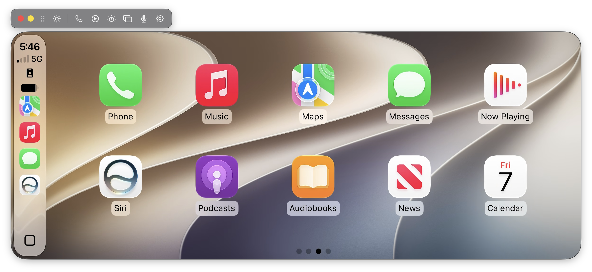
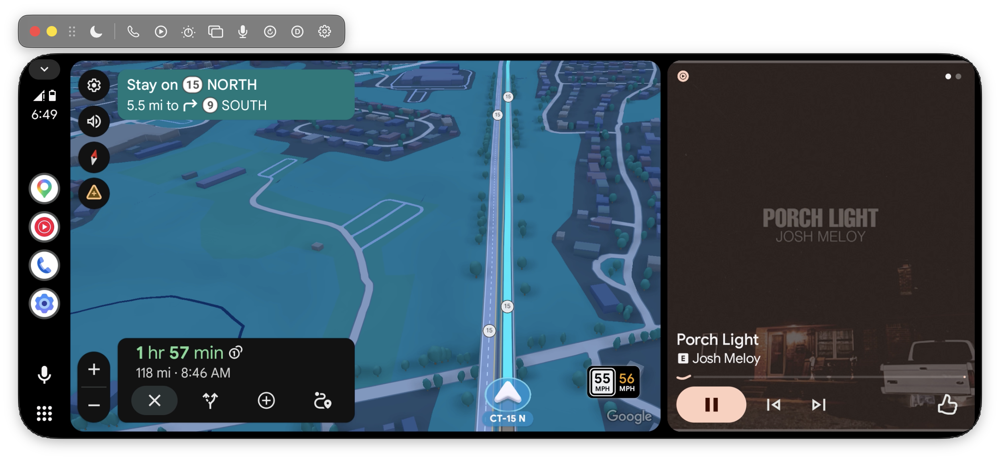

# Carlink for macOS
Carlink - CPC200-CCPA App for macOS
Personal app used for ccpa testing. Fork and use as you want, will only update as my needs change.

<!-- CORRECTED 2026-10-28: screenshots/ now holds mainUI-CP.png and mainUI-AA.png only; the earlier
     mainUI.png and settings1.png embeds pointed at files that no longer exist. No Settings screenshot is
     tracked (the former Settings > CCPA tab capture showed the box's Bluetooth/Wi-Fi MACs and serial). -->

*(The Settings ▸ CCPA tab screenshot is omitted — it displays the unit's Bluetooth/Wi-Fi MACs and
serial number.)*
